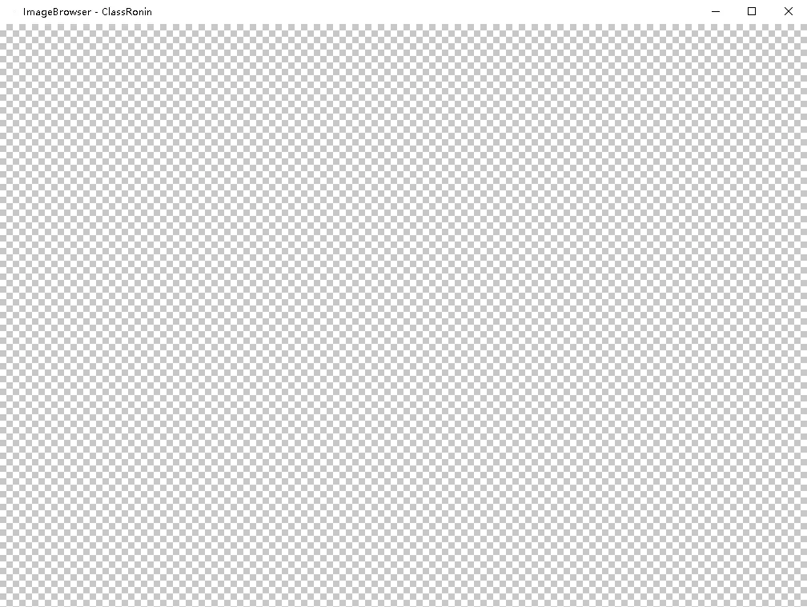

# ImageBrowser 轻量的图像浏览器

从 [jpegview](https://github.com/sylikc/jpegview) 中移除不常用，做个精简（去掉JXL/HEIF/AVIF/RAW）的图像浏览器。

下载：[ImageBrowser.zip](ImageBrowser.zip)

- 标题：ImageBrowser - ClassRonin
- 文件名：ImageBrowser.exe
- 配置名：ImageBrowser.ini（与exe同级目录）
- ini 配置：保存最大化窗口、底色、背景模式（alpha/color）（仅限关闭exe写入ini）。
- Tab 键：背景在"透明棋盘格"与"纯色底"之间切换，默认棋盘格 
- 鼠标右键/ Space 键："适应窗口" ⇄ "实际像素 1:1" 切换
- 鼠标左键：移动图像（图小于窗口时始终居中，拖不动）
- 鼠标滚动：缩放视图，切换文件恢复默认适配窗口。
- ← →键：上一张 / 下一张（当前目录内按文件名排序，首尾循环）
- ↑ ↓：顺时针 / 逆时针旋转 90°（影响本次查看，切图即复位，动图不响应，按了没反应） 
- F1 键：打开拾色器，选中的颜色作为纯色底
- Delete 键：把当前文件送进回收站，不弹确认框，可从回收站还原
- F11 / 回车键：窗口最大化 / 还原
- ESC / CTRL+W 键：关闭exe
- CTRL + 滚动：缩放2倍率（ini配置可以修改）

